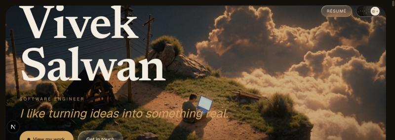
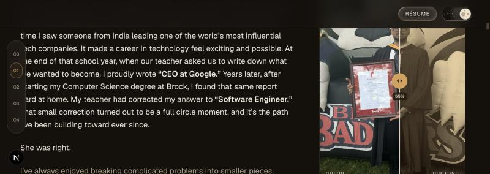
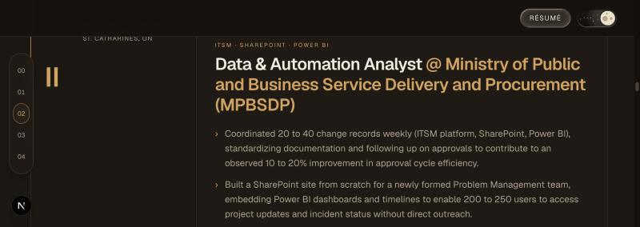
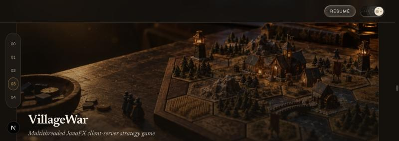
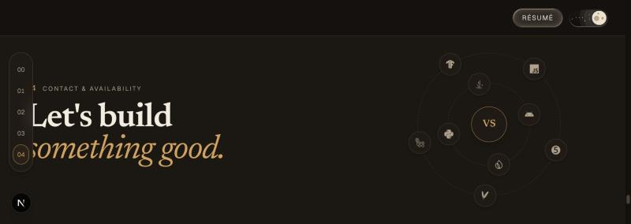

# Vivek Salwan — Portfolio

A personal portfolio site built with Next.js, TypeScript, and Tailwind CSS — designed as an editorial, motion-driven case-study site rather than a template. Every interactive detail (the glass-effect buttons, the duotone photo slider, the parallax hero, the live GitHub-backed project cards) is a custom, from-scratch implementation.

**Live:** [viveksalwan.ca](https://viveksalwan.ca) _(deploying soon)_



## Highlights

- **Parallax hero** — a looping background video with scroll-linked depth, a custom loop-seam mask that smooths the clip's restart into an intentional fade instead of a visible jump-cut, and fluid `clamp()`-based type scaling.
- **Liquid-glass buttons** — a real SVG `feTurbulence` + `feDisplacementMap` refraction filter (not just `backdrop-filter: blur()`) gives the header and hero CTAs an actual distortion effect, with a plain-blur fallback for browsers that don't support SVG filters in `backdrop-filter`.
- **Duotone photo comparison** — a drag-to-reveal slider between full color and a custom duotone grade mapped onto the site's own accent palette (built with an SVG `feColorMatrix`/`feComponentTransfer` filter, not a generic grayscale/sepia CSS filter), with full keyboard support and a `prefers-reduced-motion`-aware one-shot demo animation.
- **Live project cards** — each case study pulls real commit count, star count, language breakdown, and CI status straight from the GitHub REST API at build/request time (`src/lib/github.ts`), with a graceful fallback if the API is unavailable.
- **Day/night theme toggle** — an animated switch with a circular "reveal" transition that expands from the toggle itself, plus a blocking inline script in `<head>` so the correct theme applies before first paint (no flash of the wrong theme).
- **Skills orbit** — two concentric rings of the actual technologies behind the projects above (pulled from the same data as the case studies), animated with pure CSS so each icon stays upright while orbiting instead of tumbling with the ring.
- **Working contact form** — submits via a Next.js Route Handler to [Resend](https://resend.com) instead of opening the visitor's mail client, with server-side validation and a honeypot field for basic spam filtering.
- **Reduced-motion aware, throughout** — every custom animation (parallax, orbit, glass distortion, photo-wipe demo, preloader, theme transition) has an explicit `prefers-reduced-motion` fallback, not just a global opt-out.
- **SEO-complete** — dynamic OG image generation, JSON-LD structured data, sitemap, and robots.txt, all generated from the same single source of profile data.

<table>
<tr>
<td></td>
<td></td>
</tr>
<tr>
<td></td>
<td></td>
</tr>
</table>

## Tech stack

| | |
|---|---|
| Framework | [Next.js 16](https://nextjs.org) (App Router, Turbopack) |
| Language | TypeScript |
| Styling | [Tailwind CSS v4](https://tailwindcss.com) |
| Animation | [Framer Motion](https://www.framer.com/motion/) |
| Icons | [Phosphor Icons](https://phosphoricons.com), [react-icons](https://react-icons.github.io/react-icons/) (brand logos) |
| Email | [Resend](https://resend.com) |
| Fonts | [Geist](https://vercel.com/font) (sans), Newsreader (serif) |

No component library, no CSS-in-JS runtime, no third-party animation scaffolding beyond Framer Motion — effects that could be done in plain CSS (marquees, orbit rotation, hero drift) are, and Framer Motion is reserved for interaction-driven and scroll-linked animation.

## Getting started

```bash
git clone https://github.com/VivekSalwan2000/portfolio.git
cd portfolio
npm install
```

Create a `.env.local` in the project root for the contact form to actually send email:

```bash
# From https://resend.com/api-keys
RESEND_API_KEY=

# Where contact-form submissions get delivered (can differ from the
# publicly-displayed contact email in src/lib/data.ts)
CONTACT_TO_EMAIL=
```

Without these, the site runs fully — the contact form just returns a graceful "not configured" error instead of sending.

```bash
npm run dev
```

Open [localhost:3000](http://localhost:3000).

### Other scripts

```bash
npm run build   # production build
npm run start   # serve the production build
npm run lint    # eslint
```

## Project structure

```
src/
├── app/
│   ├── api/contact/route.ts   # Resend-backed contact form endpoint
│   ├── layout.tsx             # root layout, SEO metadata, theme init script
│   ├── page.tsx                # section assembly
│   ├── sitemap.ts / robots.ts / opengraph-image.tsx
│   └── globals.css             # design tokens, custom CSS effects
├── components/                 # one component per section/effect
└── lib/
    ├── data.ts                 # single source of truth for all site content
    ├── github.ts                # live GitHub repo data fetching
    └── theme.ts                 # brand color constants shared outside CSS
```

All page copy — name, experience, project case studies, skills — lives in `src/lib/data.ts`. There's no CMS; content changes are code changes, which keeps the whole site statically generated.

## Deployment

Built for [Vercel](https://vercel.com) (zero-config for Next.js), but runs on any Node host that supports the Next.js App Router. Remember to set `RESEND_API_KEY` and `CONTACT_TO_EMAIL` as environment variables on whatever platform you deploy to — `.env.local` is git-ignored and never deployed.

## License

Personal project — the code is here for reference, but the content (name, résumé, project write-ups) is specific to Vivek Salwan. Feel free to borrow implementation techniques; please don't republish the content as your own.
